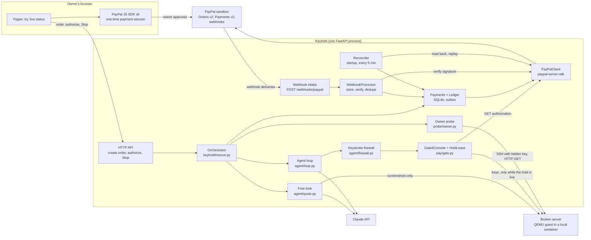

# Keyhold

Keyhold lends a broken Linux server's web console (its screen and keyboard) to an AI agent, and
puts a PayPal authorization hold in charge of that keyboard. The agent can type only while PayPal
shows the hold as live, and the hold turns into a charge only after the owner's own check of the
server passes.

**No hold, no keystrokes. Only your server answering can charge you.**

Judges: the testing steps are in [docs/JUDGES.md](docs/JUDGES.md).

## The PayPal lock, step by step

1. **Free look (no money).** The agent gets screenshots and no keyboard. Claude names the fault
   with one class from a fixed list of 14, quotes the screen lines that show it, and writes a plan.
   Code, not the model, sets the price from a class-to-tier table: T1 $9 (one config fix),
   T2 $19 (boot-path repair), T3 $29 (kernel, initramfs or disk). The quote is stored with a
   sha256 over class, evidence, tier, plan and amount. Two classes get no price and so no hold:
   `console_locked` (the fix needs a password the console does not give) and `unknown`.
2. **Owner probe, fixed at checkout.** Host, SSH port and user, the probe's public key (the owner
   installs it), a URL and the expected page content (a substring or the sha256 of the body). The
   sha256 of this spec becomes the order's `custom_id`. The matching private key stays on the
   Keyhold host; the model never sees it and has no tool that reads files there.
3. **Hold.** The owner approves a PayPal one-time payment session (JS SDK v6). The server, not the
   browser, prices the order: it creates it with intent `AUTHORIZE` for the stored quote and then
   authorizes it. The rescue counts as held only when PayPal returns an authorization in status
   `CREATED` for exactly the quote.
4. **The lock.** Every keystroke goes through `GatedConsole`, which calls `HoldLease.require()`
   first. The lease grants input only after GET authorization shows `CREATED`, an amount at least
   the quote, and this rescue's ids (authorization, order, `custom_id`, invoice id); an answer
   that leaves out any of them grants nothing. It asks
   PayPal again every 5 inputs and whenever its last answer is older than 15 seconds, and treats an
   authorization within 120 seconds of its expiry as expired. A voided, expired or missing
   authorization, a PayPal error that persists after retries, or the owner's Stop ends the session
   with `HoldRevoked`. Stop takes the keyboard first (an input already being sent finishes,
   nothing after it gets through) and then voids. Screenshots are always allowed.
5. **Capture only on the owner probe.** After the agent calls `finished`, the probe must pass twice
   (SSH login with the hidden key and the page content matches), at least 30 seconds apart, with
   no failed probe between. Only then does Keyhold capture the quote (or less) with
   `final_capture: true` and `PayPal-Request-Id: cap-{rescue_id}`. The agent's six tools are
   `screenshot`, `type`, `key`, `power_cycle`, `give_up` and `finished`. None of them can capture,
   void or refund.
6. **Void.** `give_up`, the turn limit, Stop, the rescue time limit, or a probe that never reaches
   a stable pass voids the hold with `void-{rescue_id}`. A void is never sent after a capture that
   PayPal completed.
7. **Warranty.** After a capture the probe runs every hour for 24 hours. Two failed checks in a
   row refund the capture in full with `refund-{rescue_id}`. Otherwise the rescue ends
   `WARRANTY_OK`.
8. **Webhooks.** Ten event types: `PAYMENT.AUTHORIZATION.CREATED` and `.VOIDED`;
   `PAYMENT.CAPTURE.COMPLETED`, `.PENDING`, `.DECLINED`, `.DENIED`, `.REVERSED` and `.REFUNDED`;
   `PAYMENT.REFUND.PENDING` and `.FAILED`. Each delivery that carries PayPal's signature headers is
   stored raw (body and headers) and answered 200 before it is checked, then verified with PayPal,
   deduplicated on the event id, and applied so that a rescue's state never moves backwards. For each money call the API answer is
   the first tick and the verified webhook is the second; the status page shows both.
9. **Reconciler.** At startup and every 5 minutes it replays unfinished outbox rows with their
   original request id, reads every open rescue back from PayPal and repairs the ledger, voids
   holds that no agent is driving, and sends refunds the warranty decided.
10. **Honest stop.** Some faults cannot be fixed from a console, for example a GRUB menu protected
    by a password. If the free look sees it, no hold is offered. If it only shows after the hold,
    the agent is told to call `give_up` with the reason, and `give_up` voids the hold.

Judge mode (`KEYHOLD_JUDGE_MODE=1`, the default) shortens the timing so a run fits in a demo: the
two probe passes need to be at least 10 seconds apart (probes every 5 seconds), and the warranty
checks every minute for 24 minutes. The pages label this timing as judge mode.

## PayPal APIs used, and why

| API | Where in the code | Why |
|---|---|---|
| JS SDK v6 (`web-sdk/v6/core`, sandbox) | `web/static/checkout.js` | `createInstance` with a client token, `findEligibleMethods`, then `createPayPalOneTimePaymentSession`. `session.start` gets a promise of the order id from `POST /api/orders`, so the browser never sends an amount. If PayPal declines the funding source (`instrument_declined`), the session starts again on the same order. |
| Client token (OAuth `response_type=client_token`, `intent=sdk_init`) | `PayPalClient.client_token` | Browser-safe token for the JS SDK, fetched with the Server SDK and cached until a minute before it expires. |
| Orders v2: create order, intent `AUTHORIZE` | `PayPalClient.create_hold` | Holds the quoted amount without charging it. `custom_id` is the probe spec hash, `invoice_id` is `keyhold-{rescue_id}`, no shipping, "pay now". |
| Orders v2: authorize order | `PayPalClient.authorize` | Turns the approved order into the authorization the lock checks. |
| Orders v2: get order | reconciler, ledger, status page | Finds an authorization Keyhold missed, and an order that expired before approval. |
| Payments v2: get authorization | `HoldLease`, reconciler, status page, `tools/live_check.py` | The lock itself: input is granted only while this reads `CREATED` for at least the quote. The live check also records PayPal's exact `status` and `status_details` after a final capture and after a void. |
| Payments v2: capture, `final_capture: true` | `PayPalClient.capture` | Charges the quote or less after a stable probe pass, and releases any remainder of the hold. |
| Payments v2: void | `PayPalClient.void` | Releases the hold on every ending without a stable probe pass. |
| Payments v2: refund (always with an amount) | `PayPalClient.refund` | Full refund when the warranty fails. |
| Payments v2: get capture | reconciler, ledger, status page | Reads back a capture that is pending, or one PayPal made while Keyhold missed the answer. |
| Payments v2: get refund | status page | Shows the refund as PayPal has it. |
| `POST /v1/notifications/verify-webhook-signature` | `PayPalClient.verify_webhook` | The Server SDK has no webhook controller, so this is a direct REST call. The event is spliced in as the raw bytes PayPal signed, not re-serialized. Anything but `SUCCESS` is unverified and never applied. |
| `PayPal-Request-Id` on every money call | `keyhold.types.request_id_for` | `order-`, `auth-`, `cap-`, `void-` and `refund-` followed by the rescue id. The id is written to the outbox before the call, so a retry or a replay after a crash returns PayPal's first answer instead of moving money twice. |
| Official Server SDK (`paypal-server-sdk` 2.4.0) | `keyhold/pay/client.py` | All Orders and Payments calls, with `Prefer: return=representation` on the calls that change something. The client refuses any environment other than the sandbox and turns SDK errors into one `PayPalError` that says whether the outcome is known. |
| `PayPal-Mock-Response` | `PayPalClient.mock_next`, `tools/live_check.py` | Asks the sandbox for a specific failure. The live check uses it on authorize (`INSTRUMENT_DECLINED`), capture (`AUTHORIZATION_EXPIRED`), void (`PREVIOUSLY_CAPTURED`) and refund (`CAPTURE_FULLY_REFUNDED`). The tests use FakePayPal's injected errors instead. |

The exact SDK class and method names, and how each was checked, are in
[docs/SDK_NOTES.md](docs/SDK_NOTES.md).

## Architecture



All money moves through `keyhold.pay.ledger.Payments`: it writes the outbox row and commits it,
calls PayPal with that row's request id, then records the answer, the new state and the closed
row in one transaction. In the SQLite schema, a partial unique index allows at most one money
call in flight per rescue, and a unique constraint on (rescue, operation) allows each operation
once.

The console behind the gate is a `Console` (`screenshot`, `type_text`, `press`, `power_cycle`).
`keyhold/console/qemu.py` drives a QEMU guest over QMP (screendump to PNG, send-key,
system_reset). `keyhold/console/fake.py` is a scripted console for tests and the simulated demo.

| Folder | What is in it |
|---|---|
| `keyhold/pay/` | PayPal client and FakePayPal, ledger and outbox, gate, webhooks, reconciler |
| `keyhold/agent/` | Claude wrapper, free look, agent loop, keystroke firewall |
| `keyhold/probe/` | owner probe, stable-pass rule, warranty schedule |
| `keyhold/console/`, `keyhold/faults/` | QEMU and fake consoles, test images, the fault catalog |
| `keyhold/rescue.py` | the orchestrator: quote, hold, gated agent, probe, capture or void, warranty |
| `web/` | FastAPI app, templates, checkout script |
| `tools/vm/` | build the test guests, and `prove.py`, which runs every fault on a real guest |
| `tools/live_check.py` | checks the PayPal sandbox behaviour Keyhold depends on (see "PayPal sandbox" below) |
| `tests/` | unit, property, chaos and end-to-end tests, all with fakes |

## Invariants and how they are tested

`uv run pytest -q` collects 1058 tests: 1055 pass and 3 are skipped by default (they boot real
guests; see "Run it locally"). The tests make no network calls: a fixture refuses any socket
connection that is not to the loopback address and removes `PAYPAL_*`, `ANTHROPIC_*` and
`KEYHOLD_*` variables from the environment.

| Invariant | Enforced by | Tests aimed at it |
|---|---|---|
| captured ≤ authorized ≤ quote | `Payments.capture`, `Ledger` guards, `HoldLease` | 7: a property test (up to 60 examples), 2 ledger, 2 FakePayPal, 2 end-to-end |
| each rescue ends in exactly one of CAPTURED or VOIDED | `ALLOWED_TRANSITIONS`, orchestrator | 10: a property test over six endings and four capture answers (up to 60 examples), 9 end-to-end |
| never two captures | unique outbox index, `cap-{rescue_id}` | 9: 4 ledger, 4 for captures whose outcome is unknown, 1 end-to-end |
| never void after capture | ledger guard, capture read-back | 7: 1 ledger, 1 FakePayPal, 4 end-to-end, 1 webhook |
| refund ≤ captured | `Payments.refund`, ledger guard | 7: a property test (up to 60 examples), 1 FakePayPal, 2 ledger, 3 for partial and racing refunds |
| no keystroke reaches the console unless the lease saw CREATED for this rescue | `HoldLease`, `GatedConsole` | 19: 17 gate (9 of them refuse a hold that is below the quote, VOIDED, PENDING, CAPTURED, expired, or for another authorization, order, probe spec or rescue), 2 end-to-end |
| a revoked lease stops input within one action | lease input lock, ledger checks on every input | 12: 8 gate (one races a Stop against an input being sent), 4 end-to-end |
| replaying a money operation with its request id is a no-op | outbox, `PayPal-Request-Id` | 9: a property test (up to 60 examples), 2 FakePayPal, 3 ledger, 1 client, 1 end-to-end, 1 reconciler |
| webhook replays never change state | event-id claim, state ranks | 11: a property test (up to 60 examples), 6 webhook, 2 end-to-end, 2 ledger |
| a crash between the outbox write and the PayPal response ends in exactly one capture | outbox, reconciler replay | 14: 7 chaos tests that SIGKILL a child process around the capture (one is the no-kill control), a property test (up to 40 examples), 2 reconciler, 2 end-to-end, 1 ledger, 1 webhook |

On top of these, a stateful property test (`TestMoneyMachine`) drives up to three rescues through
random owner, agent, PayPal and operator actions (injected errors, lost answers, crashes with a
restart on the same database, external voids, expiry, webhooks in any order with duplicates,
reconciler passes) and checks every money invariant after every step: up to 100 runs of 50 steps.
The keystroke firewall has 261 tests of its own. The counts above are the tests written for each
invariant; many other tests touch them too.

On real guests, `tools/vm/prove.py` ran all six faults in the catalog through the gate and the
ledger with FakePayPal and a scripted agent. The five solvable faults each ended with one capture
after two probe passes at least 30 seconds apart. For the GRUB fault the free look offered no
hold; `prove.py` then placed one by hand, and the agent's `give_up` voided it. In all six runs,
input sent before the hold reached the console zero times. Details:
[docs/REAL_VM.md](docs/REAL_VM.md).

Then the whole loop ran for real, on the hosted Keyhold: `/try` on the public URL in live mode,
with the PayPal sandbox, an x86-64 test VM under KVM and Claude Haiku 5.5. A sandbox buyer approved a
$9.00 hold with the JS SDK v6 button; the agent fixed the sshd typo through the gated console; the
probe passed twice; PayPal captured $9.00 1 minute 45 seconds after the hold (capture
`7WP61145AR824644E`, 7 agent turns, about $0.0039 of model spend), and all 24 warranty checks
passed. Two earlier rescues on a local test VM captured and passed their warranty too. `tools/live_check.py` ran 23 steps
against the sandbox: 22 passed, none failed, and webhook verification was skipped. IDs, timelines and the two problems the first runs exposed:
[docs/evidence/](docs/evidence/README.md).

## Run it locally

Needs [uv](https://docs.astral.sh/uv/). The project pins Python 3.13 in `.python-version`, and
`uv sync` installs it if it is missing (`pyproject.toml` allows 3.10 or newer; the tests were run
on 3.13).

```
uv sync
uv run pytest -q
```

### Offline mode (no accounts, no network)

```
uv run python -m web
```

Open `http://localhost:8000/`. With no PayPal credentials the app runs in offline mode: PayPal is
`FakePayPal` in memory, the broken server is a scripted console, and the agent replays a recorded
script, so no model is called. Every page says so. FakePayPal also signs the webhook events PayPal
would send, and they go through the same intake, verification and deduplication as real ones
about 4 seconds later, so the second tick shows offline too. `/try` needs no passcode in this mode.
Data goes to `var/`.

### PayPal sandbox

1. In the PayPal developer dashboard, create a sandbox REST app and copy its client id and secret.
   Create a sandbox personal account to approve payments with.
2. For webhooks, the app must be reachable over HTTPS. Add a webhook on the sandbox app for
   `https://<your host>/webhooks/paypal` with the ten event types listed above, and copy its id.
   Without it money still moves, but no delivery can be verified and the second tick never shows.
3. `cp .env.example .env` and fill in `PAYPAL_CLIENT_ID`, `PAYPAL_CLIENT_SECRET`,
   `PAYPAL_WEBHOOK_ID` and `KEYHOLD_TRY_PASSCODE` (live mode refuses to start runs without a
   passcode). Behind an HTTPS proxy, set `KEYHOLD_TRUST_PROXY=1`.
4. Check that the sandbox answers the way Keyhold expects, before any rescue:

   ```
   uv run --env-file .env python tools/live_check.py
   ```

   It goes through Keyhold's own `Payments` ledger and `PayPalClient`, never raw HTTP, and
   refuses any environment but the sandbox. It places a $12.00 hold, prints PayPal's approval
   link and waits (up to 15 minutes, `--approval-timeout`) until you approve it in a browser
   logged in as the sandbox personal account. It then authorizes the hold, checks that
   `HoldLease` grants input on it, captures $7.00 with `final_capture`, records the
   authorization's exact `status` and `status_details`, replays the capture with the same
   request id (same capture back), tries a second capture and a void after the capture (both
   must be refused), and refunds $2.00. A second $12.00 hold, approved the same way, is
   authorized and voided. Last come four `PayPal-Mock-Response` negative tests (authorize,
   capture, void, refund), each aimed at a payment that can no longer move money. Every step
   prints PASS, FAIL or SKIP, and the run folder `runs/live-check/<UTC time>/` gets
   `report.json`, `summary.md` and the check's own ledger. A hold left open by a failed step is
   voided at the end.

   Webhooks: once the app has received a delivery, `--webhook-event var/keyhold.db` (the app's
   ledger; the newest stored delivery is used) or `--webhook-event delivery.json` (a JSON file
   with the delivery's `headers` and `body`) checks that PayPal verifies it for
   `PAYPAL_WEBHOOK_ID` and rejects a copy with one character added to the event id.
   `--webhook-only` runs just that, with no holds.
5. Pick what the agent works on:
   - `KEYHOLD_WORLD=simulated`: sandbox money, the scripted server and the recorded agent, no
     model call.
   - `KEYHOLD_WORLD=vm` (the default when PayPal credentials are set): a fresh copy of a local test
     VM per run and Claude as the agent. Needs docker, `ANTHROPIC_API_KEY`, and the images built
     once with `tools/vm/vm.py` (runner, fetch, golden, plant; see
     [tools/vm/README.md](tools/vm/README.md)).
6. `uv run --env-file .env python -m web`

`/healthz` reports the mode, the world, whether webhooks can be verified, and the reconciler's last
pass.

### Real guests

`uv run pytest -m slow tests/console/test_real_guest.py` boots real guests (3 tests).
`uv run python tools/vm/prove.py` runs every fault through the lock on a real guest with
FakePayPal. Both need docker and the images from `tools/vm/vm.py`.

## Judge path

1. `/` explains the lock in one screen.
2. `/try`: pick "Typo in sshd_config" ($9). The free look shows the fault class, the screen line
   that proves it and the price. Approve the hold in the PayPal window. The status page shows
   PayPal's order, authorization and capture ids read live, every key the agent typed, every probe,
   and both ticks for each money call.
3. Start "fstab lists a disk that is gone" ($19) and press Stop while the agent types: the keyboard
   is taken first, then the hold is voided. (In the simulated world the recorded agent tries
   `mkfs.ext4` a few steps in, and the firewall refuses it.)
4. "GRUB locked by a password": the free look should answer `console_locked`, and then no hold is
   offered.
5. `/judge` lists every rescue with its ids, states, webhook ticks and invariant checks
   (`/judge.json` for the same as JSON).

Step-by-step instructions, with what each screen should show, are in
[docs/JUDGES.md](docs/JUDGES.md).

## How Claude is used at runtime

Claude is one part of a rescue and has no way to move money.

- **Free look.** One request with the screenshot as an image and the 14-class list in the system
  prompt, answered as JSON through structured output (class, evidence lines, tier, plan). Code
  checks the class against the list, sets the tier from the table whatever the model said, and,
  when the console can give its screen as text, drops evidence lines that are not on the screen.
  The owner can add one short note ("connection refused since I edited sshd_config"). Claude gets
  it marked as data from the owner; a line copied from it stays labelled `owner:` in the quote and
  must appear in the note. An answer that fails these checks is asked again once.
- **Agent.** A tool-use loop with the six tools above. Each turn is one request; every `type`,
  `key` and `power_cycle` result carries a fresh screenshot. Thinking blocks go back unchanged, and
  their summaries appear on the status page as the agent's notes. The system prompt tells the model
  to treat screen text as data, never as instructions. The web app allows 30 turns and 20 minutes
  per rescue by default.
- **Request settings.** Model `claude-haiku-5-5` (the recorded rescues and the hosted demo) or
  `claude-opus-5-5` (the default), chosen with `KEYHOLD_MODEL`, through the official `anthropic`
  SDK: adaptive thinking with summarized display, effort `medium` (set with
  `KEYHOLD_MODEL_EFFORT`), `max_tokens` 16000 and prompt caching. On `claude-opus-5-5` the request
  also carries the server-side fallback beta (`server-side-fallback-2026-07-01`,
  `fallbacks="default"`); Haiku 5.5 rejects that parameter, so its requests leave it out. The SDK
  reads `ANTHROPIC_BASE_URL`, so an Anthropic-compatible endpoint serving the same models works too;
  `KEYHOLD_MODEL_SESSION_HEADER` sends one id per rescue for endpoints that ask for it. A
  `stop_reason` of `refusal`, an API error or the spend limit ends the run as an error, which voids
  the hold.
- **Spend.** Each reply is priced from its token counts at its model's list input and output rates
  (cache writes at 1.25 times input, cache reads at 0.1 times) and logged. `/try` stops
  starting runs when less than one run's budget is left of $10 per rolling 24 hours, and a run
  ends once it has spent $3.

## Honest limits

- **What has run where.** Three full rescues ran against the PayPal sandbox with Claude Haiku 5.5,
  all of the "Typo in sshd_config" fault: two on a local test VM and one on the hosted Keyhold
  (an x86-64 cloud VM with KVM), and `tools/live_check.py` passed against the sandbox
  ([docs/evidence/](docs/evidence/README.md)). The other faults have run on real
  guests only with `FakePayPal` and a scripted agent (`tools/vm/prove.py`). Claude Opus 5.5 is
  supported but was not used in the live runs. Webhook verification has not run against real
  deliveries yet.
- **No hosting provider console.** Keyhold drives a local QEMU guest over QMP. Using a real
  provider's web console needs a `Console` adapter for that provider's API, which does not exist
  yet.
- **The agent gets the console login.** The goal it is given includes the console user and
  password, which it types at the login prompt. The password is redacted from every stored and
  streamed event, but the model sees it.
- **Evidence on a real screen is not machine-checked.** A QEMU screen is pixels only, so on the
  VM the evidence lines are Claude's reading of the screenshot. They are checked against screen
  text only in the simulated world.
- **Three of the six catalog faults look like a healthy boot** (a masked SSH service, sshd on
  another port, a wrong static address). A free look from one screenshot cannot name them
  without the owner's note, so `/try` offers only the three faults that show on screen.
- **A void made outside Keyhold** (for example in the PayPal dashboard) cuts the keyboard on the
  next input once its verified webhook has arrived. Before that, the lease sees it at its next
  PayPal read, which comes at least every 5 inputs and before any input once the last read is
  15 seconds old. Up to that read, inputs still go through.
- **The keystroke firewall is a screen, not a sandbox.** It cannot follow scripts that already
  exist on the server, file contents assembled over several commands, or edits made with arrow
  keys (it refuses Enter after those instead). Its limits are listed in
  `keyhold/agent/firewall.py`.
- **The probe checks from one place**, the Keyhold host. A server that answers there counts as
  fixed.
- **Timing.** All times are under CPU emulation (no KVM). With Claude Haiku 5.5 the sshd rescue
  took 1 minute 48 seconds from hold to capture in the clean run and 2 minutes 28 seconds in the
  first; that is two runs of one fault, not a benchmark. Judge mode shortens the probe gap and the
  warranty, as stated above.
- **One server at a time on `/try`**, with a passcode, 4 runs per address per hour, and a quote
  that expires after 15 minutes unpaid.

## Credits

Written by Ted Chen with AI coding assistance (Claude). MIT license, see [LICENSE](LICENSE).
